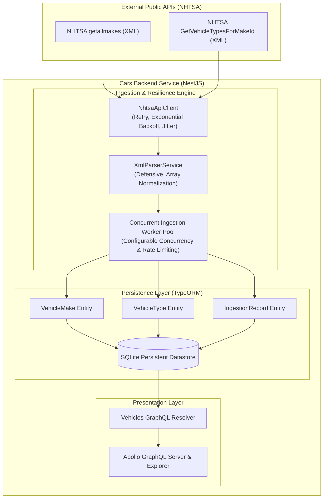
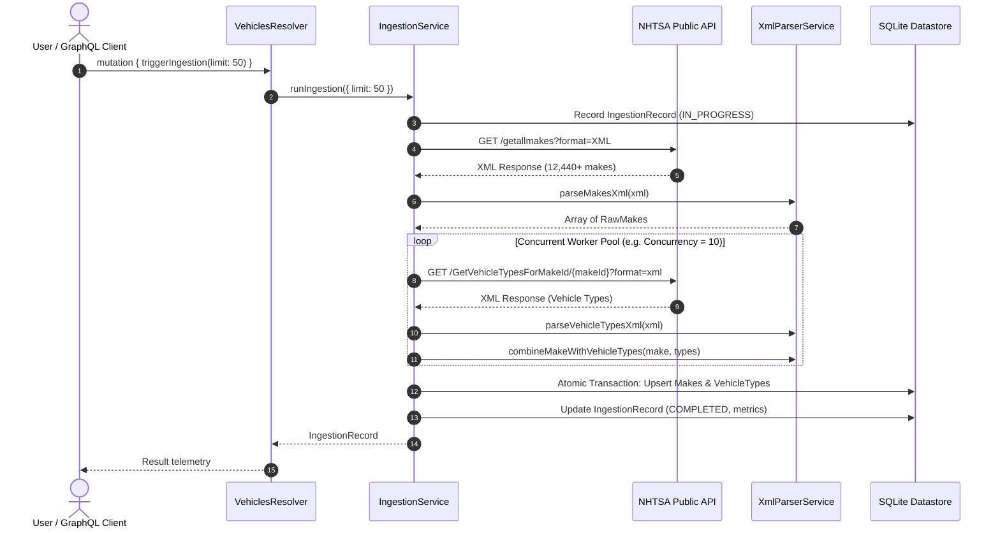

# Vehicle Data Ingestion & GraphQL Service

A robust, enterprise-grade backend service built with **NestJS**, **TypeScript**, and **TypeORM** (SQLite) that ingests XML vehicle data from public US Department of Transportation (NHTSA) APIs, transforms the polymorphic XML data into a unified JSON structure, persists it to a relational datastore, and serves it through a typed, high-performance **GraphQL endpoint**.

---

## Table of Contents

- [Architecture Overview](#architecture-overview)
- [Features](#features)
- [Data Ingestion Pipeline](#data-ingestion-pipeline)
- [Target Data Structure](#target-data-structure)
- [Getting Started](#getting-started)
  - [Prerequisites](#prerequisites)
  - [Local Installation](#local-installation)
  - [Running the Application](#running-the-application)
  - [Running with Docker](#running-with-docker)
- [Configuration](#configuration)
- [GraphQL API Documentation](#graphql-api-documentation)
  - [Schema Overview](#schema-overview)
  - [Example GraphQL Queries & Mutations](#example-graphql-queries--mutations)
- [Error Handling Strategy](#error-handling-strategy)
- [Logging Strategy](#logging-strategy)
- [Testing](#testing)
- [Continuous Integration (CI)](#continuous-integration-ci)
- [Observability](#observability)

---

## Architecture Overview

The application follows clean architectural separation between **Domain Logic**, **Infrastructure/Persistence**, and the **Presentation Layer (GraphQL)**.



---

## Features

- **NestJS v12 & Modern TypeScript**: Clean modular architecture using dependency injection, strong typing, and separation of concerns.
- **XML to JSON Transformation Engine**: High-performance parsing using `fast-xml-parser` with defensive handling of single vs multi-node XML lists, empty responses, and XML entities.
- **Unified Schema Compliance**: Transforms disparate NHTSA endpoints into the exact unified JSON specification.
- **Relational Persistence**: Uses TypeORM with `better-sqlite3` for zero-configuration, lightning-fast persistence with relational integrity and cascade updates.
- **Concurrent Ingestion Pool**: Controlled worker pool with configurable concurrency, batch slicing, timeout controls, and exponential backoff retries.
- **Typed GraphQL API**: Code-first Apollo GraphQL endpoint with rich docstrings, pagination, full-text search, and on-demand ingestion mutation.
- **Structured JSON Logging**: Enterprise-grade structured JSON logs (powered by Pino) capturing startup, shutdowns, API failures, and transformation diagnostics.
- **Zod Environment Validation**: Fail-fast configuration validation at application bootstrap with reasonable defaults across dev, test, and production environments.
- **Turnkey Dockerization**: Multi-stage, non-root user `Dockerfile` and `docker-compose.yml` for single-command production deployment.
- **Comprehensive Test Suite**: Unit, mock, and end-to-end integration test suites with >75% test coverage.

---

## Data Ingestion Pipeline

### Ingestion Sequence



### Ingestion Resiliency & Concurrency

1. **Large Scale Optimization**: NHTSA provides over 12,000 vehicle makes. Querying every make simultaneously would result in rate limiting (HTTP 429), socket starvation, or timeouts. Our ingestion pipeline implements:
   - A sliding **concurrency pool** (configurable via `INGESTION_CONCURRENCY`).
   - Configurable limits via `INGESTION_DEFAULT_LIMIT` (e.g., 50 for rapid testing, or `0` for complete dataset sync).
2. **Exponential Backoff**: `NhtsaApiClient` incorporates automatic retry logic with randomized jitter on transient HTTP 5xx errors or network drops.
3. **Partial Failure Tolerance**: If an individual make fails to retrieve vehicle types, the error is logged with structured metadata, and the pipeline continues gracefully.

---

## Target Data Structure

The transformed data adheres to the following unified JSON structure:

```json
[
  {
    "makeId": "440",
    "makeName": "ASTON MARTIN",
    "vehicleTypes": [
      {
        "typeId": "2",
        "typeName": "Passenger Car"
      },
      {
        "typeId": "7",
        "typeName": "Multipurpose Passenger Vehicle (MPV)"
      }
    ]
  }
]
```

---

## Getting Started

### Prerequisites

- **Node.js**: v20.19+ or v22.12+ (Node.js 22 LTS recommended)
- **Yarn**: v1.22+ (or npm v10+)
- **Docker & Docker Compose** (optional, for containerized execution)

### Local Installation

Clone the repository and install dependencies using Yarn:

```bash
# Clone the repository
git clone <repository-url>
cd cars-backend-challenge

# Install dependencies
yarn install
```

### Running the Application

```bash
# Development mode with hot-reload
yarn run start:dev

# Production build and run
yarn run build
yarn run start:prod
```

Once running, navigate to:
- **GraphQL Playground / Explorer**: [http://localhost:3000/graphql](http://localhost:3000/graphql)
- **Application Port**: `http://localhost:3000`

### Running with Docker

The service includes a multi-stage `Dockerfile` and `docker-compose.yml` for local execution with minimal setup:

```bash
# Build and start container in detached mode
docker compose up -d --build

# View real-time logs
docker compose logs -f

# Stop container
docker compose down
```

The database file is persisted to `./data/vehicles.sqlite` on the host machine via Docker volume binding.

---

## Configuration

Configuration is managed via environment variables and validated at startup using **Zod**. If any required environment variable is invalid, the service fails fast with actionable error messages.

Copy `.env.example` to `.env` to customize settings:

```bash
cp .env.example .env
```

### Environment Variables

| Variable | Type | Default | Description |
| :--- | :--- | :--- | :--- |
| `NODE_ENV` | `string` | `development` | Application environment (`development`, `production`, `test`, `staging`). |
| `PORT` | `number` | `3000` | Port on which the HTTP server listens. |
| `DATABASE_PATH` | `string` | `./data/vehicles.sqlite` | SQLite database file location (`:memory:` for in-memory testing). |
| `LOG_LEVEL` | `string` | `info` | Minimum log level (`fatal`, `error`, `warn`, `info`, `debug`, `trace`). |
| `NHTSA_BASE_URL` | `string` | `https://vpic.nhtsa.dot.gov/api/vehicles` | NHTSA Vehicle API base URL. |
| `INGESTION_CONCURRENCY` | `number` | `10` | Maximum parallel requests during vehicle type ingestion. |
| `INGESTION_DEFAULT_LIMIT` | `number` | `50` | Number of makes to process if no limit is specified (set `0` for all). |
| `SYNC_ON_STARTUP` | `boolean` | `false` | Automatically trigger ingestion in the background on startup. |
| `EXTERNAL_API_TIMEOUT_MS` | `number` | `15000` | HTTP request timeout in milliseconds for external API calls. |
| `EXTERNAL_API_MAX_RETRIES` | `number` | `3` | Maximum number of retry attempts for failed HTTP requests. |
| `OBSERVE_APP_KEY` | `string` | `YOUR_APP_KEY` | Optional NestJS Observe application key. |
| `OBSERVE_APP_SECRET` | `string` | `YOUR_APP_SECRET` | Optional NestJS Observe secret key. |

---

## GraphQL API Documentation

The service exposes a single GraphQL endpoint at `/graphql`.

### Schema Overview

The code-first GraphQL schema is automatically generated at `schema.gql`:

- **Types**:
  - `VehicleMake`: Automotive make entity with `makeId`, `makeName`, timestamps, and nested `vehicleTypes`.
  - `VehicleType`: Vehicle category with `typeId`, `typeName`, and parent `makeId`.
  - `IngestionRecord`: Operational telemetry representing pipeline execution status.
- **Queries**:
  - `makes(limit: Int = 50, offset: Int = 0, search: String): [VehicleMake!]!`
  - `make(makeId: String!): VehicleMake`
  - `vehicleTypes(makeId: String, search: String, limit: Int = 100): [VehicleType!]!`
  - `ingestionStatus: IngestionRecord!`
- **Mutations**:
  - `triggerIngestion(limit: Int): IngestionRecord!`

### Example GraphQL Queries & Mutations

#### 1. Trigger Data Ingestion
Trigger the ingestion pipeline for the first 25 makes:

```graphql
mutation TriggerIngestion {
  triggerIngestion(limit: 25) {
    id
    status
    totalMakes
    processedMakes
    failedMakes
    startedAt
    completedAt
    errorMessage
  }
}
```

#### 2. Query Transformed Vehicle Makes
Retrieve makes and nested vehicle types matching the target JSON specification:

```graphql
query GetVehicleMakes {
  makes(limit: 10, offset: 0) {
    makeId
    makeName
    vehicleTypes {
      typeId
      typeName
    }
  }
}
```

#### 3. Search Vehicle Makes
Filter makes by name or ID:

```graphql
query SearchMakes {
  makes(search: "ASTON", limit: 5) {
    makeId
    makeName
    vehicleTypes {
      typeId
      typeName
    }
  }
}
```

#### 4. Query Single Make by Make ID
```graphql
query GetSingleMake {
  make(makeId: "440") {
    makeId
    makeName
    createdAt
    updatedAt
    vehicleTypes {
      typeId
      typeName
    }
  }
}
```

#### 5. Check Ingestion Telemetry
```graphql
query CheckIngestionStatus {
  ingestionStatus {
    status
    totalMakes
    processedMakes
    failedMakes
    startedAt
    completedAt
  }
}
```

---

## Error Handling Strategy

The service implements a defense-in-depth error handling strategy:

1. **Network Layer**:
   - `AbortController` timeouts prevent hanging connections.
   - Exponential backoff with random jitter handles transient network hiccups and temporary server outages.
   - Errors are wrapped in `ExternalApiException` preserving the original status code and URL for diagnostic clarity.
2. **Parsing Layer**:
   - `XMLValidator` pre-validates XML syntax.
   - `fast-xml-parser` is configured to normalize polymorphic elements (single XML objects vs arrays of objects) into arrays.
   - Syntax failures throw `XmlParsingException` and are logged with structured inputs.
3. **Transformation Layer**:
   - Validates that mandatory fields (e.g. `makeId`) exist.
   - Throws `TransformationException` when inputs are corrupt or invalid.
4. **Datastore Persistence**:
   - Database operations run inside **atomic transactions** (`queryRunner.startTransaction()`).
   - If an insertion error occurs, the transaction rolls back, preventing corrupt or half-written states.

---

## Logging Strategy

The application produces **structured JSON logs** using **Pino**, enabling seamless ingestion by log collectors (DataDog, CloudWatch, Grafana Loki, Google Cloud Logging):

- **API Request Failures**: Captures endpoint, HTTP status code, attempt count, and stack trace.
- **Transformation Errors**: Captures the failed operation name, source data fragment, and error message.
- **Unexpected Exceptions**: Global exception capture with contextual metadata.
- **Lifecycle Events**: Structured `APPLICATION_STARTUP` and `APPLICATION_SHUTDOWN` events with node version, environment, and port details.

Sample JSON log entry:
```json
{"level":"error","time":"2026-11-23T10:04:18.115Z","pid":89256,"hostname":"app-runner","event":"API_REQUEST_FAILURE","endpoint":"https://vpic.nhtsa.dot.gov/api/vehicles/getallmakes","error":"Service Unavailable","statusCode":503,"attempt":3,"msg":"API request failed for endpoint: https://vpic.nhtsa.dot.gov/api/vehicles/getallmakes"}
```

---

## Testing

The project includes unit tests, external API mock tests, and end-to-end integration tests:

```bash
# Run unit & integration test suites
yarn test

# Run tests in watch mode
yarn test:watch

# Generate code coverage report
yarn test:cov

# Run linter
yarn lint
```

### Test Coverage Highlights

- **`src/transformation/xml-parser.service.spec.ts`**: Comprehensive coverage of XML parsing, polymorphic lists, empty tags, malformed syntax, and JSON transformation matching the gist shape.
- **`src/ingestion/nhtsa-api.client.spec.ts`**: Verifies mock HTTP requests, retry logic, timeout aborts, and error handling.
- **`src/ingestion/ingestion.service.spec.ts`**: Tests concurrent worker pool, batch persistence, duplicate run prevention, and failure tolerance.
- **`src/database/database.spec.ts`**: Tests TypeORM entities, relations, cascading, and SQLite transactions.
- **`src/vehicles/vehicles.service.spec.ts` & `vehicles.resolver.spec.ts`**: Tests GraphQL queries, pagination, search, and mutations.
- **`test/e2e-integration.spec.ts`**: Full pipeline test covering ingestion -> persistence -> GraphQL query resolution.

---

## Continuous Integration (CI)

A GitHub Actions workflow is provided in `.github/workflows/ci.yml`. On every push and pull request to `main` or `master`, the workflow:
1. Installs clean dependencies via `yarn install --frozen-lockfile`.
2. Runs code quality checks (`yarn lint`).
3. Executes the test suite and collects coverage (`yarn test:cov`).
4. Compiles the TypeScript codebase (`yarn build`).
5. Builds the production Docker image.
6. Publishes the coverage report as an artifact.

---

## Observability

The service is pre-instrumented for [NestJS Observe](https://observe.nestjs.com) through `ObserveModule`.
To connect your environment:
```bash
npx @nestjs/observe link
```
This automatically links the application and provisions telemetry keys into your `.env` file.
